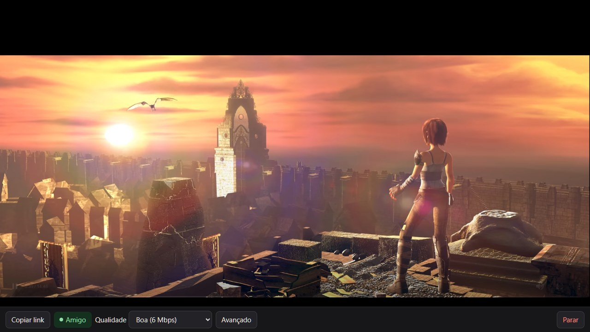
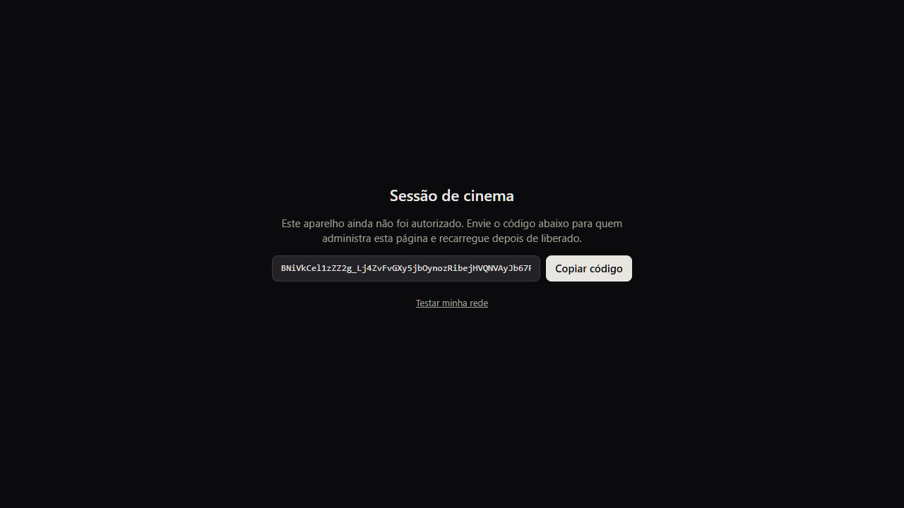
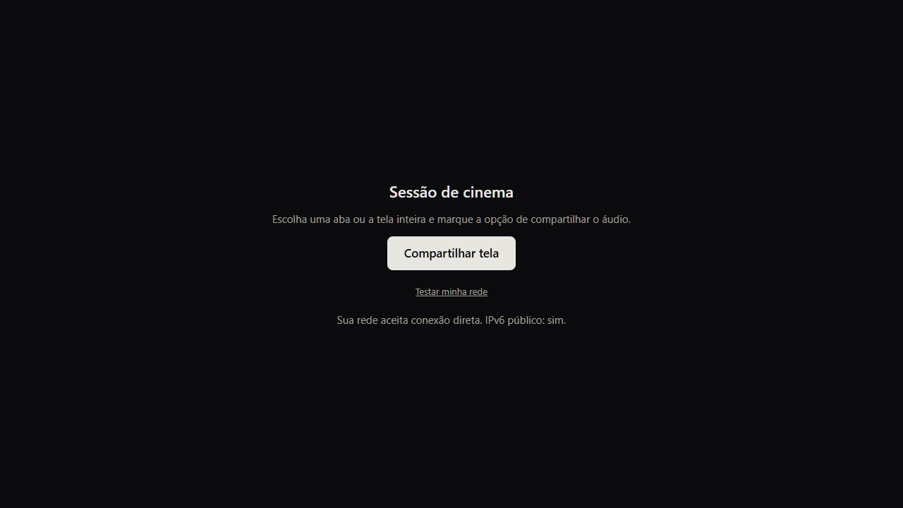
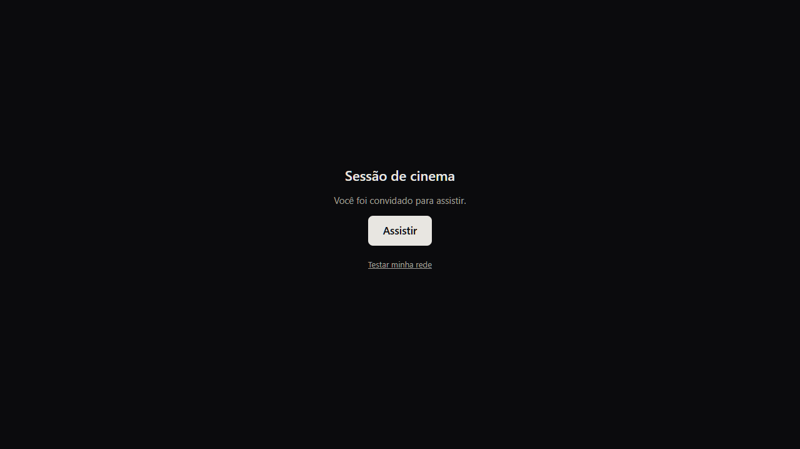
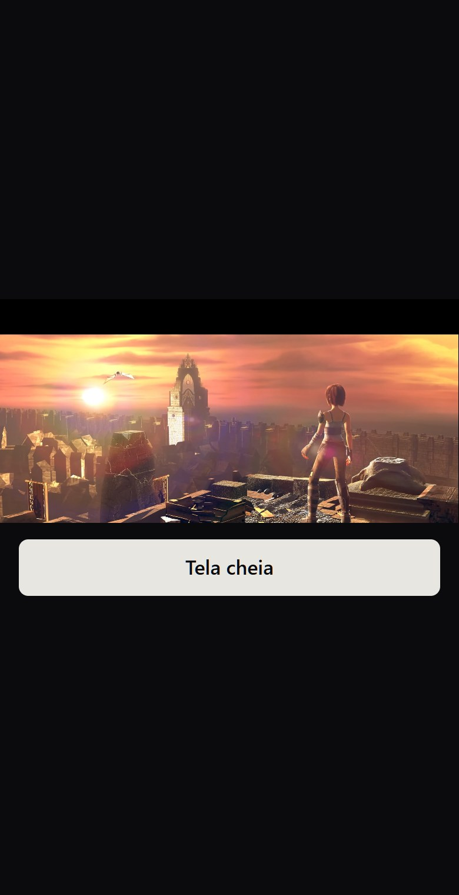
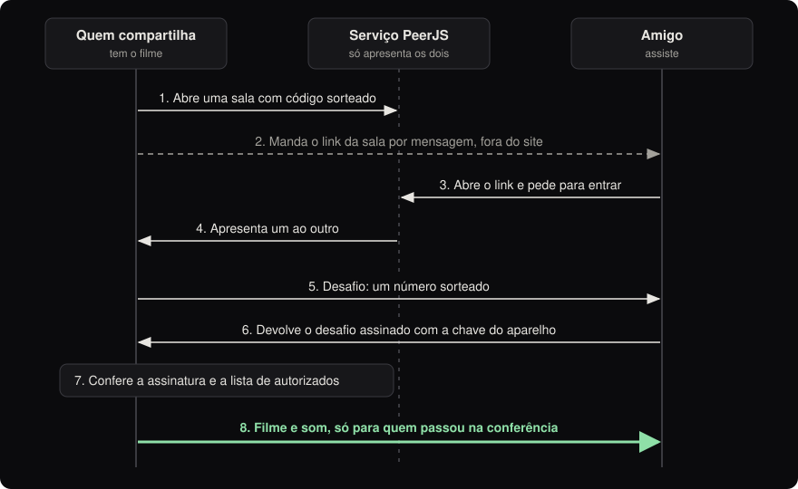

# Sessão de cinema

Uma página para assistir a um filme junto com os amigos, cada um na sua casa. Uma pessoa compartilha a tela do computador e os outros assistem pelo navegador, no computador ou no celular.

**Endereço da página:** https://mrclpisani.github.io/sessao-cinema/



## O que é

É um site de uma página só. Não tem programa para instalar, não tem cadastro com e-mail e senha e não tem servidor próprio: o filme vai direto do navegador de quem compartilha para o navegador de cada amigo.

Só entra quem foi autorizado. Cada aparelho recebe um código próprio, e o dono da página decide quais códigos podem participar.

## Para que serve

Os aplicativos de chamada tratam a tela compartilhada como uma apresentação de trabalho: filtram o som como se fosse voz e diminuem a imagem quando a internet aperta. Para filme, isso estraga a música, os efeitos e a nitidez.

Aqui os ajustes foram escolhidos pensando em filme:

- **Som em estéreo e sem filtros de voz**, para a trilha e os efeitos chegarem como são.
- **Imagem em até 1080p a 30 quadros por segundo.** Quando a rede aperta, a página prefere perder quadros a borrar a imagem.
- **Um pequeno atraso proposital (0,6 segundo) em quem assiste**, que dá tempo de repor falhas da rede antes de a imagem travar.
- **Até 8 amigos por sessão.**

## Como usar

### 1. Autorizar o aparelho (só na primeira vez)

Ao abrir a página em um aparelho novo, ela mostra o código daquele aparelho. A pessoa copia o código e envia para quem administra a página.



Quem administra acrescenta uma linha no arquivo [autorizados.json](autorizados.json) com o nome da pessoa e o código recebido:

```json
{ "nome": "Fulano", "chave": "código que a pessoa enviou" }
```

Cerca de um minuto depois de salvar, a pessoa recarrega a página e já está liberada. O código vale para aquele navegador naquele aparelho. Outro navegador ou outro celular precisa de um código novo.

### 2. Compartilhar a tela

No computador de quem tem o filme, a página mostra o botão **Compartilhar tela**. O navegador pergunta o que mostrar: escolha a aba do filme (ou a tela inteira) e marque a opção de compartilhar o áudio.

O link **Testar minha rede** diz se a internet daquele aparelho aceita conexão direta. Vale usar antes da primeira sessão.



### 3. Chamar os amigos

Com o compartilhamento ligado, aparece uma barra embaixo do filme (é a primeira imagem desta página):

- **Copiar link** copia o endereço da sala para mandar aos amigos. O link muda a cada sessão.
- **Um selo por amigo** mostra quem está assistindo. Verde quer dizer que está indo bem; amarelo, que a rede ou o computador está no limite. Parando o mouse sobre o selo aparecem os números, por exemplo: `1080p · 30 fps · 6 Mbps — boa`.
- **Qualidade** escolhe quanto de internet usar: Econômica (3 Mbps), Boa (6 Mbps) ou Máxima (10 Mbps).
- **Avançado** troca a forma de compactar o vídeo: VP9 (mais leve para o computador) ou AV1 (imagem melhor, exige mais do computador).
- **Parar** encerra a sessão para todo mundo.

A barra também avisa quando o filme está indo sem som e quando a tela inteira está visível (notificações e outras janelas aparecem para quem assiste).

### 4. Assistir

O amigo abre o link recebido e toca em **Assistir**.



No celular em pé, o filme ocupa uma faixa e aparece um botão grande de **Tela cheia**. Se a conexão cair (troca de rede, celular em segundo plano), a página tenta reconectar sozinha.



> As imagens são de uma sessão de verdade, com uma aba compartilhando e outra assistindo no mesmo computador; a do celular é o navegador no tamanho de tela de um celular. O filme é *Sintel*, © copyright Blender Foundation | [durian.blender.org](https://durian.blender.org), usado sob a licença [Creative Commons Atribuição 3.0](https://creativecommons.org/licenses/by/3.0/).

## Como funciona



- **O serviço PeerJS só apresenta os navegadores.** Ele é um serviço público e gratuito que ajuda um navegador a achar o outro. O filme não passa por ele: vai direto de um navegador para o outro, protegido pela criptografia que o próprio navegador aplica (WebRTC).
- **A autorização é por aparelho.** Cada navegador cria um par de chaves. A chave privada fica guardada no navegador e não pode ser copiada para fora dele; a chave pública é o "código do aparelho". Antes de enviar o filme, quem compartilha sorteia um desafio e o amigo devolve assinado. Só recebe o vídeo quem assina certo e está na lista.
- **Ter o link não basta.** Um link vazado não abre a sala para um aparelho que não está em `autorizados.json`.
- **A página só roda o próprio código.** Uma trava do navegador (CSP) impede carregar código de outros sites, e a biblioteca PeerJS fica guardada aqui no repositório em vez de vir de fora.

## Riscos de usar

Este é um projeto pessoal, feito para um grupo pequeno de amigos, e não passou por auditoria de segurança. Usado como descrito acima o risco é baixo, mas existe. O que vale saber antes:

**Privacidade**

- **O endereço IP aparece para o outro lado.** Como a conexão é direta, quem compartilha vê o IP de cada amigo e cada amigo vê o IP de quem compartilha. Um amigo não vê o IP do outro. O IP revela a operadora e a região aproximada.
- **Um link vazado não mostra o filme, mas expõe o IP de quem compartilha.** A conferência do aparelho acontece depois que os dois navegadores se conectam. Um estranho com o link não recebe imagem nem som, mas consegue descobrir o IP de quem compartilha enquanto a sessão estiver aberta. Mande o link só para os amigos; ele deixa de valer quando a sessão termina.
- **Compartilhar a tela inteira mostra tudo:** notificações, mensagens e outras janelas. A página avisa quando isso acontece. Prefira compartilhar só a aba do filme.
- **Os nomes da lista são públicos.** O arquivo `autorizados.json` pode ser lido por qualquer pessoa na internet, com o nome escrito em cada linha. Use um apelido se não quiser o nome exposto. Os códigos da lista não são segredo: sozinhos, sem o aparelho, não servem para entrar.

**Acesso**

- **Quem usa o seu navegador entra como você.** A chave fica guardada no navegador autorizado. Outra pessoa (ou um programa malicioso) com acesso a esse navegador participa em seu nome. Para cortar um aparelho, apague a linha dele em `autorizados.json`; a mudança vale na conexão seguinte e, para quem já está assistindo, em até meio minuto.
- **Quem controla o repositório controla a página.** Quem conseguir editar este repositório pode mudar a lista de autorizados e o próprio código. Proteja a conta do GitHub com verificação em duas etapas.
- **Limpar os dados do navegador apaga a chave.** O aparelho passa a ter um código novo e precisa ser autorizado de novo.

**Serviços de terceiros**

- **O serviço PeerJS e os servidores de endereço do Google e da Cloudflare** não recebem o filme, mas veem o IP e o horário de quem se conecta. São gratuitos e sem garantia: se o PeerJS sair do ar, não dá para abrir sessão nova.
- **A página confia no PeerJS para apresentar os navegadores corretamente.** Um serviço de apresentação mal-intencionado poderia, em teoria, se colocar no meio da conexão.

**Internet e direitos**

- **Consumo de dados.** Na qualidade Boa são até cerca de 2,7 GB por hora para cada pessoa que assiste (1,35 GB na Econômica e 4,5 GB na Máxima). Quem compartilha envia essa quantidade para cada amigo. Em internet móvel isso consome a franquia rápido.
- **Direitos autorais.** A lei brasileira (Lei 9.610/1998, art. 29) exige autorização do titular para exibir a outras pessoas um filme protegido, e isso também pode contrariar os termos do serviço de onde o filme vem. Não há esse risco com filmes de licença livre ou em domínio público e com vídeos seus. A responsabilidade pelo que é transmitido é de quem compartilha.

## Limites conhecidos

- **Algumas redes não conectam.** A conexão é direta, sem servidor retransmissor (que custa dinheiro). Internet móvel (4G/5G), algumas operadoras e VPNs podem impedir a conexão. O botão "Testar minha rede" mostra se é o caso.
- **Mais amigos exigem mais do computador de quem compartilha.** O vídeo é compactado uma vez para cada espectador. Por isso o limite de 8.
- **Compartilhar precisa de um computador.** Assistir funciona também no celular. A página foi feita e testada no Chrome e no Edge; as facilidades do seletor de tela (abrir na lista de abas e trocar de aba sem compartilhar de novo) são desses navegadores, e os outros as ignoram.

## Arquivos

| Arquivo | Para que serve |
|---|---|
| [index.html](index.html) | A página inteira: aparência e funcionamento. |
| [autorizados.json](autorizados.json) | Lista dos aparelhos que podem participar. |
| [peerjs.min.js](peerjs.min.js) | Biblioteca PeerJS 1.5.5, que conecta os navegadores. |
| [peerjs.LICENSE.txt](peerjs.LICENSE.txt) | Licença da PeerJS (MIT), que precisa acompanhar a cópia da biblioteca. |
| [LICENSE](LICENSE) | Licença deste projeto (MIT). |
| `README.md` e `docs/` | Esta explicação e as imagens dela. |

## Para ter a sua própria página

1. Faça uma cópia (fork) deste repositório.
2. Ligue o GitHub Pages nas configurações da cópia, publicando o ramo `main`.
3. Esvazie `autorizados.json`, deixando só `[]`. Abra a sua página, copie o código do seu aparelho e acrescente a sua linha.

Para testar no próprio computador, sirva a pasta e abra `http://localhost:8765`:

```bash
python -m http.server 8765
```

O código do aparelho muda conforme o endereço: o que vale em `localhost` não vale na página publicada.

## Licença

O código desta página usa a licença [MIT](LICENSE): pode ser copiado e modificado livremente, desde que o aviso de autoria seja mantido. A biblioteca PeerJS tem a licença dela em [peerjs.LICENSE.txt](peerjs.LICENSE.txt).
